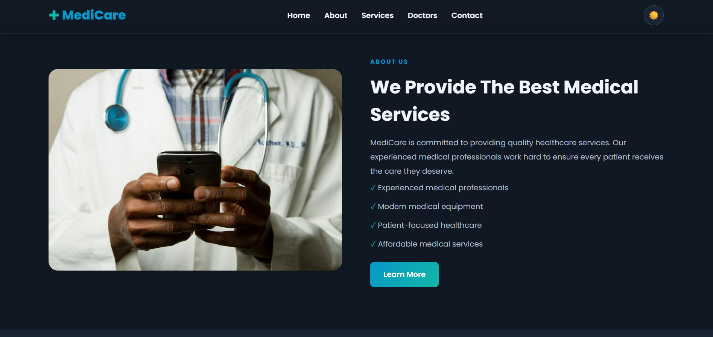

# 🏥 MediCare – Modern Healthcare Website

A modern, responsive healthcare website built with **React.js and CSS**. MediCare provides a clean and user-friendly interface with medical services, doctor profiles, appointment forms, and Dark/Light Mode.

## 📸 Screenshots

### 🏠 Home Page – Light Mode


### 🌙 Home Page – Dark Mode


### 🩺 About & Services



### 👨‍⚕️ Our Doctors


### 📩 Contact & Appointment


## ✨ Features

- Modern and professional healthcare design
- Fully responsive layout
- Dark Mode and Light Mode toggle
- Theme preference saved in local storage
- Responsive navigation menu
- About Us section
- Medical services section
- Doctor profiles
- Appointment request form
- Smooth scrolling
- Hover animations
- Clean and reusable React components

## 🛠️ Technologies Used

- React.js
- JavaScript
- HTML5
- CSS3
- React Hooks (`useState`, `useEffect`)
- Local Storage

## 📂 Project Structure

```text
MediCare/
│
├── public/
│
├── src/
│   ├── components/
│   │   ├── Navbar.jsx
│   │   └── Navbar.css
│   │
│   ├── Home.jsx
│   ├── Home.css
│   ├── App.jsx
│   ├── App.css
│   ├── index.css
│   └── main.jsx
│
├── screenshots/
│   ├── home-light.png
│   ├── home-dark.png
│   ├── services.png
│   ├── doctors.png
│   └── contact.png
│
├── package.json
└── README.md
```

## ⚙️ Installation & Setup

**1. Clone the repository**

```bash
git clone YOUR_GITHUB_REPOSITORY_URL
```

**2. Open the project folder**

```bash
cd MediCare
```

**3. Install dependencies**

```bash
npm install
```

**4. Start the development server**

```bash
npm run dev
```

Open your browser and visit:

```text
http://localhost:5173
```

## 🌗 Dark & Light Mode

MediCare includes a theme switcher that allows users to switch between Dark Mode and Light Mode. The selected theme is saved using browser Local Storage.

## 📱 Responsive Design

The website is designed to work on:

- Desktop computers
- Laptops
- Tablets
- Mobile phones

## 👨‍💻 Developer

**Abdullah Bashir**

- GitHub: [abdullahbshir](https://github.com/abdullahbshir)

## 📄 License

This project is created for learning and portfolio purposes.

---

⭐ If you like this project, consider giving it a star!